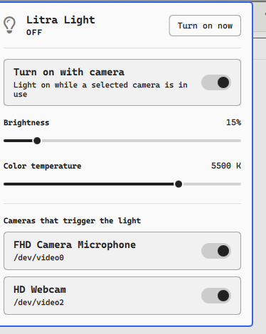

# Litra Light

An [Omarchy](https://omarchy.org) shell plugin that turns a Logitech Litra light on while your webcam is in use, and off when it isn't.



A bar button opens a panel with:

- a switch for the camera trigger
- brightness (1–100%) and color temperature (2700–6500 K), applied live while the light is on
- one switch per connected camera, so only the ones you pick trigger the light
- a **Turn on now** button to switch the light by hand

## Requirements

| Package | Why |
|---|---|
| [`litra`](https://aur.archlinux.org/packages/litra) (AUR) | controls the light |
| `jq` | reads and writes the config |
| `inotify-tools` | notices cameras opening and closing |
| `psmisc` | `fuser`, to see whether a camera is in use |

Tested with a Litra Glow. The `litra` CLI also supports Beam and Beam LX; those should work but are untested here.

## Install

```bash
omarchy plugin add https://github.com/Ewerton/omarchy-litra-light --enable
```

Then add **Litra Light** to the bar if it isn't there already:

```bash
omarchy bar put ewer.litra-light --section right
```

## Remove

```bash
omarchy plugin remove ewer.litra-light
```

This stops the watcher and takes the widget off the bar. The plugin only ever writes `~/.config/litra-light/config.json`; delete `~/.config/litra-light` too if you want its settings gone. Nothing else in your configuration is changed.

## How it works

`Service.qml` keeps `bin/litra-light-watcher` running. It watches the camera device nodes with inotify and checks them with `fuser`. When a selected camera has been open for 2 seconds the light turns on, and it turns off 3 seconds after the last one closes, so apps that only probe the camera and back-to-back calls don't flicker the light.

Only the primary capture node of each camera (`/dev/v4l/by-id/*-video-index0`) is watched, so infrared or metadata nodes, such as a face-unlock camera, never trigger the light.

Settings are stored in `~/.config/litra-light/config.json` and are picked up as soon as they change:

```json
{ "enabled": true, "brightness": 20, "temperature": 6000, "disabledCameras": [] }
```

`bin/litra-light-ctl` is the only thing that writes that file, and works from a terminal too:

```bash
litra-light-ctl get
litra-light-ctl cameras
litra-light-ctl set brightness 40
litra-light-ctl set temperature 5000
litra-light-ctl camera <camera-id> off
litra-light-ctl light toggle
```

A light switched on by hand stays on until you turn it off. If a camera opens and closes meanwhile, the watcher takes over and turns it off when the camera closes.

## Translations

English and Brazilian Portuguese (`i18n/`). The panel follows the language set in Omarchy.

## License

MIT
